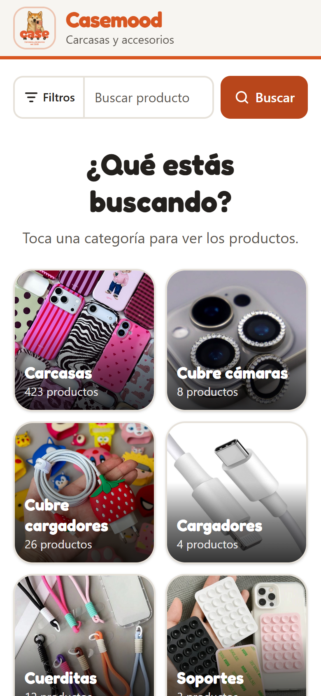
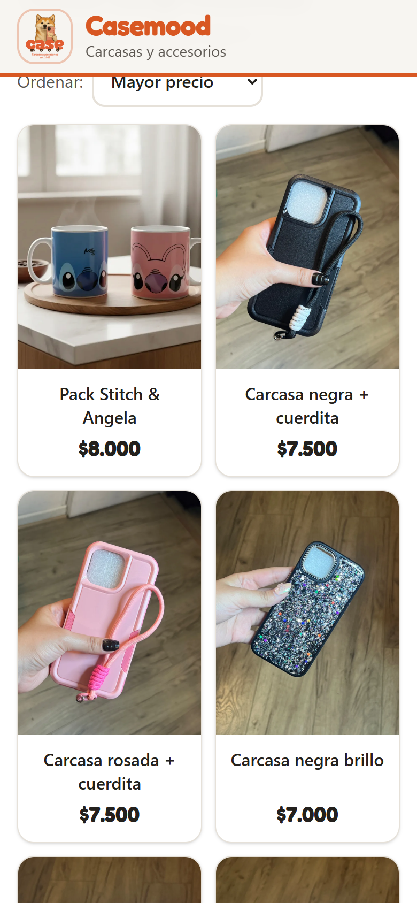
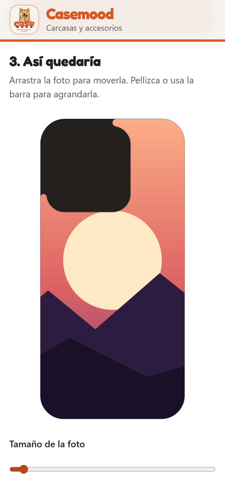
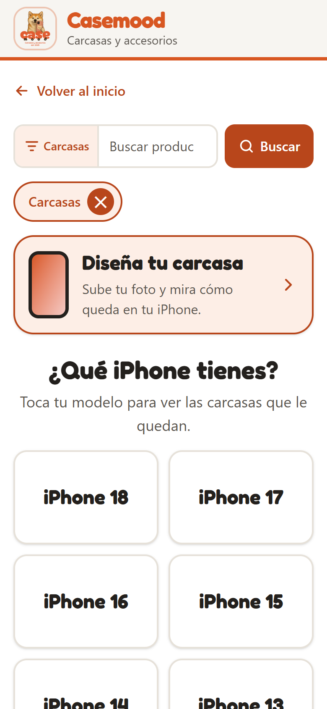
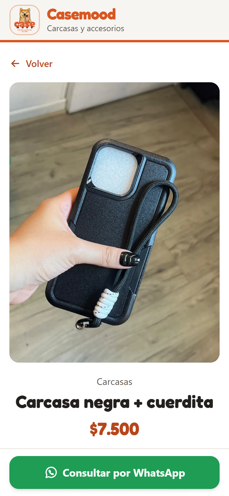
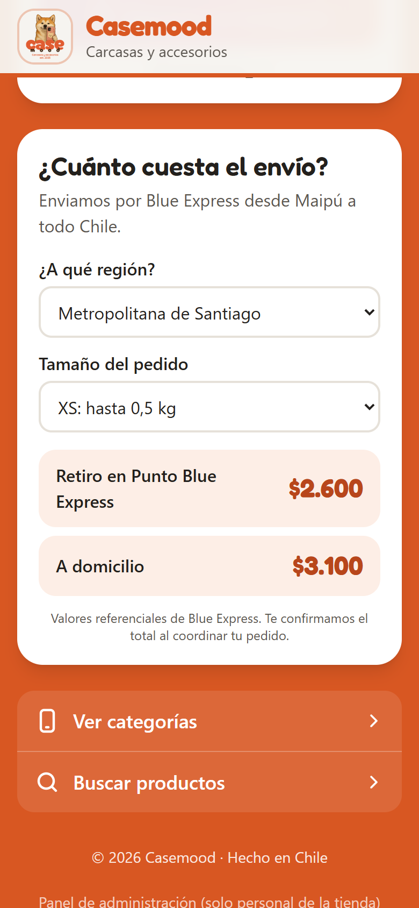

# Casemood

**Catálogo web y panel de administración para una tienda real de accesorios para iPhone.**

🟢 **En producción:** [casemood.cl](https://casemood.cl) — la tienda Casemood (Maipú, Chile) lo usa a diario para mostrar su
catálogo de más de 480 productos y recibir pedidos por WhatsApp.

<p align="center">
  
  
  
</p>

---

## El problema

Casemood vendía por Instagram y WhatsApp con un catálogo armado en Glide: lento, difícil de mantener y sin forma
de que el cliente encontrara rápido lo que le sirve a **su** iPhone. Además, la mayoría de sus clientes entra desde el
celular y muchos no son usuarios avanzados.

## La solución

Una tienda **mobile-first** pensada para que cualquier persona encuentre su producto en pocos toques, y un panel para
que la dueña administre todo desde el celular, sin depender de nadie.

### Para los clientes

- **"¿Qué iPhone tienes?"**: se elige el modelo una vez y el catálogo muestra solo lo compatible (los modelos sin stock
  aparecen en gris). La tienda recuerda el modelo en las siguientes visitas.
- **Búsqueda y filtros** por categoría, orden por precio o novedad y paginación.
- **Pedido por WhatsApp** con un mensaje ya escrito que incluye el producto y el modelo del cliente.
- **Diseña tu carcasa**: el cliente sube una foto y ve al instante cómo quedaría impresa en la carcasa de su modelo,
  la mueve con el dedo, la agranda y comparte la vista previa por WhatsApp. Los contornos salen de las plantillas de
  sublimación reales de la tienda (26 modelos, del iPhone 11 al 17 Pro Max). Todo ocurre en el navegador: la foto
  nunca se sube al servidor.
- **Cotizador de envíos** por región y tamaño, con las tarifas reales de Blue Express.
- Accesible: textos de 16 px o más, botones de al menos 48 px y siempre con texto (sin íconos sueltos).

### Para la tienda (panel `/admin`)

- Productos con fotos tomadas desde el celular (se comprimen a WebP en el navegador antes de subirlas), precio,
  categoría y compatibilidad por modelo con disponibilidad.
- Filtros por categoría y por modelo de iPhone, vista en cuadrícula igual a la del catálogo.
- Modelos, versiones, categorías (con foto de portada) y tarifas de envío por zona, todo editable.
- Acceso solo con Google y solo para los correos autorizados.

<p align="center">
  
  
  
</p>

## Tecnologías

| Área | Tecnología |
|---|---|
| Frontend y servidor | **Next.js 16** (App Router, Server Components, Server Actions) · **TypeScript** · **Tailwind CSS 4** |
| Hosting | **Cloudflare Workers** con [OpenNext](https://opennext.js.org/cloudflare) · dominio propio con HTTPS |
| Base de datos | **PostgreSQL en Neon** · **Prisma 7** con driver adapter (cliente por request, sin conexiones persistentes) |
| Imágenes | **Cloudflare R2**, servidas desde el mismo dominio con caché inmutable |
| Autenticación | **Auth.js** (Google OAuth) con lista de correos autorizados |
| Validación | **Zod** en cada Server Action |

## Decisiones técnicas destacadas

- **Todo dentro del plan gratuito de Cloudflare (Worker de 3 MiB).** El Worker queda en ≈2,4 MiB gzip gracias a usar el
  compilador de consultas *small* de Prisma, excluir del empaquetado lo que no corre en producción y minificar con
  Wrangler. Se eligió `middleware.ts` (edge) en vez de `proxy.ts` porque este último subía el Worker a ~4 MiB.
- **Seguridad del panel en tres capas**: chequeo optimista de la sesión en el middleware, verificación del correo en el
  layout del panel y `assertAdmin()` en cada Server Action y endpoint. Ningún secreto está en el código.
- **Plantillas de sublimación → contornos web**: un script ([`scripts/plantillas-carcasas.mjs`](scripts/plantillas-carcasas.mjs))
  lee los SVG de las plantillas, detecta el contorno de la carcasa por geometría y genera archivos JSON de ~1,5 KB por
  modelo. La vista previa los dibuja en `<canvas>` con recorte (`clip`), arrastre y pellizco.
- **Migración de datos**: el catálogo se importó desde Glide con un script idempotente que convierte categorías en
  compatibilidades por modelo, optimiza cada foto con `sharp` y la sube a R2
  ([`prisma/importar-glide.ts`](prisma/importar-glide.ts)).
- **Datos verificados, no estimados**: las tarifas y zonas de envío se cargaron cotizando cada región en Blue Express, y
  son editables desde el panel hasta integrar su API.

## Estructura

```
src/
  app/(tienda)/      Catálogo público: inicio, categorías, modelos, productos, búsqueda, diseñador
  app/admin/         Panel de administración (protegido)
  app/api/           Auth.js, subida de imágenes, health check
  app/img/           Imágenes desde R2
  components/        Componentes de la tienda y del panel
  lib/               Acceso a datos, autenticación, formatos y utilidades
prisma/              Schema, migraciones, datos iniciales e importador desde Glide
public/carcasas/     Contornos de carcasa por modelo (generados)
scripts/             Generador de contornos y utilidades
```

## Correr el proyecto

```bash
npm install
cp .dev.vars.example .dev.vars   # completar con los datos propios
npm run db:deploy                # aplicar migraciones en Neon
npm run db:seed                  # datos iniciales
npm run dev                      # http://localhost:3000
```

La guía completa (variables de entorno, Google OAuth, despliegue en Cloudflare, scripts de datos y detalles técnicos)
está en [`docs/desarrollo.md`](docs/desarrollo.md).

## Autor

**Francisco Baeza** — [github.com/Frbaeza](https://github.com/Frbaeza)

Diseño, desarrollo, despliegue y migración de datos del proyecto completo, trabajando directamente con la tienda.

---

Proyecto desarrollado para un cliente real y publicado como portafolio con su autorización. El código se comparte
como referencia; la marca, el logo y las fotos de productos pertenecen a Casemood. Todos los derechos reservados.
